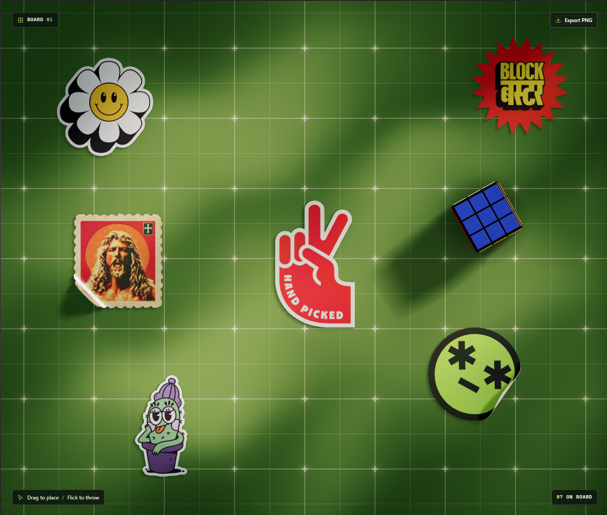

# Stickboard

An interactive 3D board for arranging stickers and objects under soft, moving light. Peel sticker corners, change the board and lighting, and export your composition as a PNG.



## Getting started

Use Node.js 20.19+ in the 20.x series, or Node.js 22.12 or newer.

```bash
npm install
npm run dev
```

Open the local address shown by Vite in a browser with WebGL 2 support.

## Using the board

- Choose a sticker or object from the library, or drag it onto the board.
- Pull a sticker edge to peel it. Select a sticker to adjust its size and rotation.
- Upload a PNG to create a sticker, or upload a GLB with embedded resources as a 3D object.
- Select an object to rotate or scale it with the gizmo and proportional scale slider.
- Change the board color and adjust the light pattern, position, intensity, and spread.
- Select **Export PNG** to save the board.

## Development

```bash
npm test
npm run build
```

Stickboard uses Three.js, cannon-es, and Vite.
